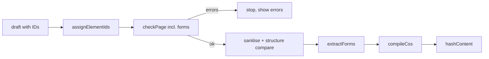

# T11 Build the HTML pipeline package

Build `packages/html`, the pure functions the Loft and the publish action run on a page's draft HTML. They check it against the house rules and return fixable, line-numbered errors, sanitise it, give every element a stable `data-r2c2-id`, extract `<site-form>` definitions, and compile the page's Tailwind CSS against the site's theme.

## Context

- **Where the behaviour is defined.** SPEC §4 ("Publishing a page", steps 1–2), §7 (sanitising rules) and §12 (house rules) define the behaviour. §6 defines the shapes it feeds:
  - `pages.draftHtml`
  - `pageVersions.hash`, `cssHash` and `forms`
  - `forms.fields`: name, type, required, maxLength
  - `sites.theme`: Tailwind `@theme` tokens plus `@utility` component classes
- **What exists today.** `packages/html/src/index.ts` is an empty stub. `packages/core` already has the zod enquiry schema, the R2 key helpers and SHA-256 hex hashing, which is private in `signing.ts`.
- **Who calls it.**
  - Convex draft saves (T09/T15) assign IDs.
  - The Loft preview and the AI editor show the same errors before a publish.
  - The publish action (T13) runs the full pipeline.

  Tailwind's compiler and html-validate need Node APIs, so `checkPage` and `compileCss` run in `"use node"` Convex actions. `assignElementIds`, `extractForms` and `sanitise` don't depend on Node.

- **Trust.** Milestone 1 HTML is written by people, the Loft's AI and MCP clients, so all of it is untrusted.

## Approach

### Input

`draftHtml` is the whole page, including its metadata: a `<head>` with `<title>` and `<meta name="description">`, and a `<body>`. The site's `theme` CSS is passed alongside it. Adding the canonical URL, the CSS link and the elements script, and choosing what gets hashed, are T13's job. This package exports a `hashContent` helper for that.

### One allow-list, two uses

`allowlist.ts` is the single source for:

- the allowed tags: document and metadata (`html`, `head`, `body`, `title`, and `meta` limited to `charset`, `viewport` and `description`), structural, text, list, table, media (`img`, `picture`, `source`) and form elements (`form`, `label`, `input`, `textarea`, `select`, `option`, `button`);
- the platform custom tags, an exact list that is just `site-form` for now;
- the attributes allowed globally (`class`, `data-r2c2-id`, `aria-*`, `role`, `lang`, `dir`, `title`) and per tag;
- the allowed URL schemes.

The house-rule check and the sanitiser both read it, so they can't drift apart. `script`, `style`, `iframe`, `object`, `embed`, `svg`, `math`, `template` and `noscript` are left out. That keeps out the namespaces where mutation XSS lives.

### Parse once, with positions

`parse.ts` wraps `htmlparser2` with `domhandler` and keeps start indices, so any node maps to a line and column. Every step that walks the tree uses it.

### Element IDs: `assignElementIds(html, newId?)`

- IDs are random: 8 characters, base36, from Web Crypto.
- Each element is assigned an ID once and keeps it. An element that already has a `data-r2c2-id` keeps it, and elements without one get a new ID.
- When a duplicate turns up (copy and paste), the first one in document order keeps it and later ones get new IDs.
- `newId` can be injected so tests are deterministic.

It's pure and idempotent, and it's meant to run **inside the Convex mutation that saves a draft**. IDs then exist before the AI editor needs them, and there's no read-modify-write race with concurrent edits. The publish action runs it again as a guarantee; on an already-ID'd draft that changes nothing.

### Forms: `extractForms(html)`

For each `<site-form name="…">` it returns `{ forms, errors }`, where each form is `{ name, fields: [{ name, type, required, maxLength }] }`, matching `forms.fields`.

- **Fields** are `textarea`, `select` and every `input` except types `submit`, `reset`, `button`, `image` and `hidden`. The element fills its own hidden inputs.
- **Errors**, in the check's shape: a missing or duplicate form name within the page, a field without `name`, and duplicate field names within one form.

### House rules: `checkPage(html, theme)`

It returns `{ errors, warnings }`, each item being `{ line, column, rule, message }`. Each message is written to be fixed directly, e.g. `Line 12: bg-[#1f5b8a] isn't allowed. Use a theme colour: bg-brand, bg-ink, bg-paper.` Errors block a publish; warnings don't. `checkPage` includes `extractForms`'s errors, so one call gives the full list.

- **Allow-list.** It flags unknown tags or attributes, `on*` handlers, `style` attributes and non-allowed URL schemes, including `javascript:` and `data:`.
- **Theme.**
  - Any arbitrary value, arbitrary property or variable shorthand (a class token containing `[` or `(`, after any variants) is an error. This covers `bg-[#1f5b8a]`, `font-[Georgia]`, `[color:red]` and `bg-(--x)` without guessing which utility family a bracket belongs to.
  - Every other class must compile. The check asks Tailwind's design system which candidates produce CSS, and a class with none is an error: "isn't a theme class". That includes plain non-Tailwind classes, since published pages run no scripts of their own that could use them.
  - An element with more than 8 utility classes and no component class gets a warning that suggests a component class.
- **Media and requests.** `img`/`source` URLs must be site media paths (`/assets/<hash>.<ext>`, served by the renderer in T06). No absolute URL may appear in an attribute that makes a request (`src`, `srcset`, `poster`). Outbound `<a href>` is allowed. Every `img` has non-empty `alt`.
- **Structure and accessibility.** These run through `html-validate` with a pinned rule config: one `h1`, heading levels in order, labelled form fields, and no empty links.
  - Its element metadata is extended to cover `site-form`.
  - Two rules sit in our own check rather than html-validate: generic link text ("click here", "read more", "here", "link") and non-empty `alt` on every `img`.
  - html-validate's own positions become our `{ line, column }`.
- **Metadata and size.** It requires exactly one non-empty `<title>` and one non-empty `<meta name="description">` in the head, and HTML at most 500 KB.

### CSS: `compileCss(html, theme)`

One module, `theme.ts`, owns Tailwind. `loadTheme(themeCss)` compiles the theme once and returns a `Theme` that `checkPage` and `compileCss` both take, so a publish compiles it only once.

- It builds the input CSS as `@import "tailwindcss"`, then a reset `@theme` that sets `--color-*`, `--font-*`, `--radius-*` and `--shadow-*` to `initial`, then the site theme. The pipeline injects the reset, so the default palette never leaks in, whatever the stored theme says.
- A `loadStylesheet` callback resolves the `tailwindcss` import from the installed package.
- Candidates are the `class` tokens from our parse, not Tailwind's file scanner.
- `compile(...).build(candidates)` produces the CSS.
- The theme rule's "does this class compile?" question goes through `__unstable__loadDesignSystem(...).candidatesToCss()`, which returns `null` for invalid classes. It's isolated behind `Theme.invalidClasses`, so the pinned `tailwindcss` version is the only place that knows about the unstable API.

### Sanitise: `sanitise(html)`

`sanitize-html` is configured from the allow-list and runs after the check passes, as the backstop. If sanitising changes the parsed element and attribute structure of a page that passed the check, the publish fails with an internal "check missed something" error. It never ships the silently changed page, because that would be a checker gap.

### Hashing

`sha256Hex` moves from private code in `packages/core/src/signing.ts` to an exported helper in core. `hashContent` truncates it to 16 hex characters for `versions/<hash>.html` and `assets/<cssHash>.css`.

### Publish order (T13)

## Alternatives considered

- **Hand-written sanitiser over our own parse:** this would avoid a second parse, but a home-grown sanitiser is where XSS bugs live. sanitize-html is pinned in SPEC §2 and well-tested.
- **parse5:** its positions are just as good, but sanitize-html already parses with htmlparser2. Sharing a parser family keeps the check and the sanitiser seeing the same tree.
- **Content-derived IDs (hash of tag + path + text):** these change whenever text or position changes, which breaks AI-edit targeting and history.
- **Assigning IDs only at publish:** the AI editor needs IDs before a publish, and saving them back from an action races with concurrent edits.
- **Building each candidate on its own with the public `compile()` API to find unknown classes:** this avoids the unstable API, but it's one build per class. It's the fallback if `candidatesToCss` goes away.
- **Classifying arbitrary values by utility family (colour, font, radius, shadow):** prefixes are ambiguous (`bg-[#fff]` vs `bg-[url(...)]`). Banning all arbitrary values is simpler and matches "theme only".

## Scope

- In:
  - `packages/html`: the allow-list, parse, `checkPage`, `sanitise`, `assignElementIds`, `extractForms`, `compileCss` and `hashContent`
  - exporting `sha256Hex` from core
  - catalog entries for the new dependencies
  - tests
- Out:
  - assembling the full document and the R2 writes (T12/T13)
  - calling `assignElementIds` from the draft-save mutation (T09/T15)
  - the Loft UI for errors (T15)
  - `<site-form>` runtime behaviour (T18)
  - checking that a form name used on two pages has matching fields (T13 owns the per-site registry)

## Action items

- [x] Add `htmlparser2`, `domhandler`, `domutils`, `dom-serializer`, `sanitize-html` (+ types), `html-validate` and `tailwindcss` to the catalog and `packages/html`; check versions with `vp outdated`
- [x] Export `sha256Hex` from `packages/core`, use it in `signing.ts`, and add `hashContent`
- [x] Write `allowlist.ts` and `parse.ts` (positions → line/column)
- [x] Implement `assignElementIds` and `extractForms`
- [x] Implement `theme.ts` (`loadTheme`: input CSS with the reset, `loadStylesheet`, `invalidClasses`, `build`) and `compileCss`
- [x] Implement `checkPage`: allow-list, theme, media, metadata/size and form rules
- [x] Wire html-validate: pinned rule config, `site-form` metadata, position mapping
- [x] Implement `sanitise` and the structure comparison
- [x] Add a test theme fixture (tokens, `btn`/`card`/`section`/`prose`) and tests for every rule
- [x] Record the ADRs below; run `vp check`, `vp test`, `vp run build`

## Testing

`vp test` suites in `packages/html`, one per module, with a small fixture theme:

- **House rules:** every rule has a failing case with the expected line, column and message, plus a clean page that passes with no errors.
- **Theme:** `bg-brand` passes; `bg-red-500`, `bg-[#fff]`, `md:hover:bg-[#fff]`, `[color:red]`, `bg-(--x)` and `js-toggle` fail; the 8-utility warning fires.
- **Sanitiser:** `<script>`, `on*`, `style`, `javascript:` (entity-encoded, mixed-case), `svg`/`math` payloads and known mXSS strings are stripped. Allowed content passes through with an unchanged structure, and a planted checker gap triggers the structure-compare error.
- **IDs:** existing IDs are kept, new elements get IDs, duplicates are re-IDed in document order, IDs survive a text edit and a reorder, and a second run changes nothing.
- **Forms:** field extraction, which input types are excluded, `required`/`maxlength`, and the duplicate or missing name errors.
- **CSS:** a theme class compiles, the default palette and fonts don't, and the hash is stable for identical input.

## Risks

- **Parser differential (mXSS):** browsers and htmlparser2 can disagree on odd markup. Mitigation: no foreign-content namespaces, sanitise as the last step, the CSP from SPEC §5, and tests with known mXSS payloads.
- **Unstable Tailwind API:** `candidatesToCss` could change in a minor release. Mitigation: pinned version, one wrapping function with its own tests, and the per-candidate `compile()` fallback above.
- **html-validate weight and Node dependency:** it runs only in Node actions, not at the edge. If bundling in Convex becomes a problem, replace it with our own rules for the handful of structural checks.
- **IDs depend on editors keeping attributes:** if a client drops `data-r2c2-id`, the next save assigns new IDs. Mitigation: T15's editor preserves attributes, and the AI and MCP edit tools patch elements by ID instead of rewriting the page.

## Decisions

- [ADR-004](../decisions/ADR-004-html-pipeline-libraries.md): HTML pipeline libraries
- [ADR-005](../decisions/ADR-005-persist-random-element-ids.md): persist random element IDs in the draft

## Resolved questions

- The page's metadata is part of its HTML: `<title>` and `<meta name="description">` live in the draft's `<head>`.
- All arbitrary values are banned for now, spacing and sizing included. They can be loosened later.
- Images come only from the site's R2 media; there are no `data:` images.
- The utility-class threshold for the component-class warning starts at 8. It's easy to tune.
